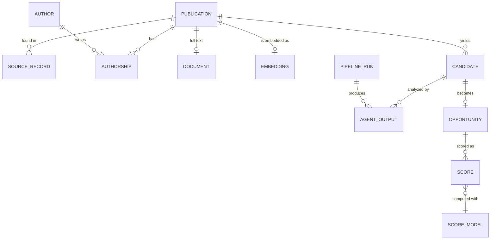

# Data model

The logical records the platform stores. Table and column names are decided with the first migration; the storage service for each record is proposed in ADR 0004.

## Records

| Record | Holds | Requirement |
|---|---|---|
| Publication | Canonical record: title, abstract, publication date, DOI, arXiv ID, topics, citation count, completeness, retraction flag | REQ-DATA-005, REQ-DATA-008 |
| Source record | The raw record from one source, with source ID, fetch date, and metadata license | REQ-DATA-001, REQ-DATA-002, REQ-DATA-007 |
| Author and authorship | Public name, ORCID when known, affiliation per publication | REQ-NFR-009 |
| Document | Stored PDF key, content hash, license, extracted text key, extractor version | REQ-DATA-004, REQ-DATA-006, REQ-DATA-010 |
| Embedding | Vector ID, model name and version, created date | REQ-PROC-001, REQ-PROC-002 |
| Ingestion run | Source, cursor, start, end, counts, failures | REQ-DATA-009, REQ-NFR-008 |
| Triage decision | Publication, triage score, accepted or rejected, reason | REQ-PROC-005 |
| Candidate | Publication, finding, evidence quote | REQ-PROC-004 |
| Pipeline run | Candidate, status, start, end, cost | REQ-AGENT-007, REQ-NFR-005 |
| Agent output | Envelope and output (see [contract conventions](../agents/contract-conventions.md)) | REQ-AGENT-007, REQ-AGENT-008 |
| Opportunity | Candidate, status (`complete`, `incomplete`, `hidden`), current score | REQ-SCORE-005 |
| Score | Five category values, explanation, final score, band, score model version | REQ-SCORE-001, REQ-SCORE-004 |
| Score model | Version, weights, derivation rule version | REQ-SCORE-003 |
| User | Email, name, role, status, terms accepted date | REQ-ACC-003, REQ-ACC-006 |
| Invitation | Email, role, inviting user, token hash, expiry, status | REQ-ACC-002 |
| Session and sign-in link | Token hash, user, expiry, used flag | REQ-ACC-004 |
| Audit event | Actor, action, time; never a token | REQ-ACC-009 |

## Identity and deduplication

- Every publication has an internal ID that never changes. Source IDs are stored on source records.
- Records are matched by DOI, then arXiv ID, then the IDs that OpenAlex lists for a work (REQ-DATA-007). DOIs are compared in lowercase without the `https://doi.org/` prefix.
- arXiv versions update the same publication; the latest version number is stored.
- A match on title and first author only is flagged for review, never merged automatically.

## History

Agent outputs and scores are never overwritten. A rerun creates a new pipeline run, and the opportunity points to its latest complete score. This keeps old scores explainable after a prompt, model, or score model change.

## Deletion

A publication is not deleted when it is retracted; it is flagged (REQ-DATA-008). Deletion is only for records ingested by mistake or on request. It removes the vector, the stored files, and the opportunities that depend only on that publication.
