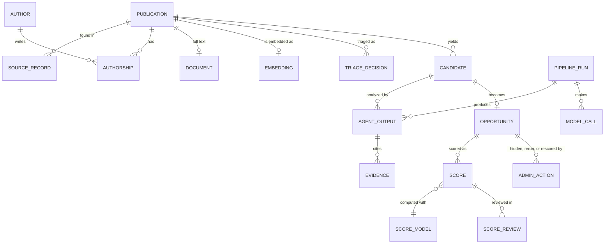

# Data model

The logical records the platform stores. Physical table and column names for the first migration are in [schema migration 0001](schema-migration-0001.md) (ADR 0020, REQ-NFR-020). Storage services per record are decided in ADR 0004.

## Records

| Record | Holds | Requirement |
|---|---|---|
| Publication | Canonical record: title, abstract, publication date, DOI, arXiv ID, topics, citation count, completeness, retraction flag | REQ-DATA-005, REQ-DATA-008 |
| Source record | The raw record from one source, with source ID, fetch date, and metadata license | REQ-DATA-001, REQ-DATA-002, REQ-DATA-007 |
| Author and authorship | Public name, ORCID when known, affiliation per publication | REQ-NFR-009 |
| Document | Stored PDF key, content hash, license, extracted text key, extractor version | REQ-DATA-004, REQ-DATA-006, REQ-DATA-010 |
| Embedding | Vector ID, model name and version, created date | REQ-PROC-001, REQ-PROC-002 |
| Ingestion run | Source, cursor, start, end, counts, failures | REQ-DATA-009, REQ-NFR-008 |
| Triage decision | Publication, triage score, accepted or rejected, reason | REQ-PROC-005 |
| Candidate | Exactly one publication, finding, evidence quote | REQ-PROC-004 |
| Pipeline run | Candidate, status, start, end, cost | REQ-AGENT-007, REQ-NFR-005 |
| Agent output | Envelope and output (see [contract conventions](../agents/contract-conventions.md)) | REQ-AGENT-007, REQ-AGENT-008 |
| Model call | Run ID, step, agent, model, prompt version, attempt, input and output tokens, latency, cost, estimated flag, outcome; no prompt or publication text | REQ-NFR-011 |
| Evidence | Agent output, field, kind (`publication-quote`, `related-publication`, `external-url`, `none-found`), quote, URL, retrieval date | REQ-AGENT-008 |
| Opportunity | Exactly one candidate, pipeline status (`complete`, `incomplete`, `hidden`), hidden reason, current score; user decision status lives in opportunity status entry | REQ-SCORE-005, REQ-ADM-001, REQ-DASH-004 |
| Admin action | Actor, action (`hide`, `unhide`, `rerun`, `rescore`), opportunity, reason, time | REQ-ADM-001, REQ-ADM-002, REQ-ADM-003 |
| Queue message log | Message ID, type, schema version, status, attempts, dead-letter flag | REQ-DATA-011 |
| Score | Five category values, explanation, final score, band, score model version | REQ-SCORE-001, REQ-SCORE-004 |
| Score model | Version, weights, derivation rule version, currency rate table, active flag | REQ-SCORE-003, REQ-ADM-003 |
| Score review | Score ID, user, date, state (`confirmed` or `disputed`), reason | REQ-SCORE-007 |
| Opportunity status entry | Opportunity, user, date, status (`pursued`, `parked`, `rejected`), note | REQ-DASH-004 |
| Organization | ID, name; one record in the MVP | REQ-NFR-018 |
| User | Organization, email, name, role, status, terms version and date accepted | REQ-ACC-003, REQ-NFR-012, REQ-NFR-018 |
| Invitation | Email, role, inviting user, token hash, expiry, status | REQ-ACC-002 |
| Session and sign-in link | Token hash, user, expiry, used flag | REQ-ACC-004 |
| Audit event | Opaque actor ID, action, time; never a token or a name | REQ-ACC-009 |
| Delivery event | Invitation or sign-in email, provider event (`delivered`, `bounced`, `complained`), time | REQ-ACC-007 |
| Legal document version | Terms or privacy policy, version, date | REQ-ACC-011 |

## Identity and deduplication

- Every publication has an internal ID that never changes. Source IDs are stored on source records.
- Records are matched by DOI, then arXiv ID, then the IDs that OpenAlex lists for a work (REQ-DATA-007). DOIs are compared in lowercase without the `https://doi.org/` prefix.
- arXiv versions update the same publication; the latest version number is stored.
- A match on title and first author only is flagged for review, never merged automatically.

## Cardinality

One publication yields zero or more candidates. A candidate has exactly one publication and becomes at most one opportunity (ADR 0015). Related publications from semantic search are context on the Research Analyst output, not sources of the opportunity. Every record that a user writes carries a user ID and an organization ID (ADR 0019, REQ-NFR-018). The research corpus (publications to scores) is shared.

## History

Agent outputs, scores, and score reviews are never overwritten. A rerun creates a new pipeline run, and the opportunity points to its latest complete score. This keeps old scores explainable after a prompt, model, or score model change.

## Deletion

A publication is not deleted when it is retracted; it is flagged (REQ-DATA-008). Deletion is only for records ingested by mistake or on request. It removes the vector, the stored files, and the candidates and opportunities of that publication. Erasure of author data is in [privacy](privacy.md) (REQ-NFR-016).
