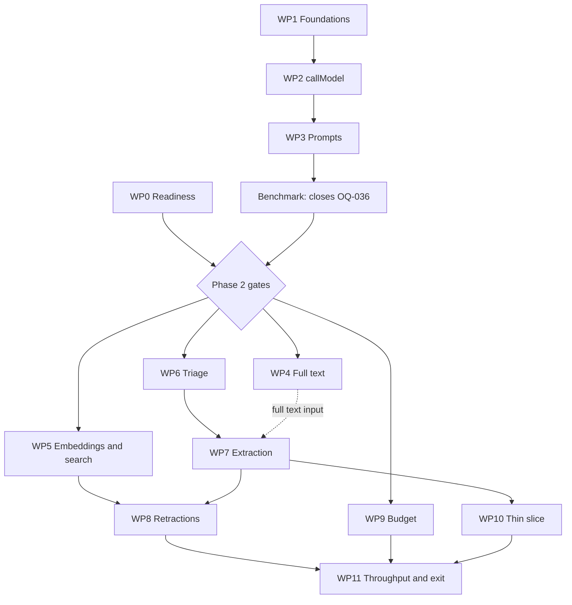

# Phase 2 dependencies

## Gates

Phase 2 starts only when every gate below is closed ([Definition of Ready](../roadmap.md#definition-of-ready-for-a-phase)). WP0 to WP3 of the [build plan](build-plan.md) may run before then, because the benchmark that closes OQ-036 needs them.

| Gate | State on 2026-11-06 | Owner | Evidence that closes it |
|---|---|---|---|
| Phase 1 exit | Met on the data criterion of ADR 0051 (arXiv 13,372 and OpenAlex about 11,100 publications with an abstract on 6 Nov); to be confirmed on the runs of 7 Nov after the ADR 0048 filter | Lead engineer | The re-run of `Staging scheduled checks` recorded in [ingestion scope](../data-sources/ingestion-scope.md), after ADR 0045, ADR 0047, and ADR 0048 |
| OQ-014: legal phase-2 gate questions | Answered: questions 1 to 5 approved on 2026-11-06 with no conditions; the contact is `info@solarnode.cc`. Launch questions 6 to 12 stay open | `@SolarnodeCC` and legal | The [review brief](../legal/review-brief.md). Workers AI processing falls under the Cloudflare agreement of launch question 8 (ADR 0049) |
| OQ-036: models for triage and extraction | Open; round one covers triage and extraction only, two candidates each (benchmark plan) | AI engineering lead | Benchmark ADR on the golden sets ([benchmark plan](../test/model-benchmark-plan.md)); needs WP1 to WP3 |
| OQ-040: providers | Answered by ADR 0049: Workers AI for the pipeline, Anthropic as the eval judge only | `@SolarnodeCC` | ADR 0049 |
| OQ-038: population-level burden | Answered by ADR 0050 (REQ-PROC-009 AC6) | Product owner | ADR 0050; the first extraction eval run reviews the rule |
| OQ-005 benchmark run (ADR 0010) | Reference model fixed; benchmark not run | AI engineering lead | Recall report on the corpus of ADR 0057 (Proposed) and an ADR if the model changes from `bge-base-en-v1.5` |
| Cost per publication (REQ-NFR-005) | Estimate recorded (EUR 0.0014) with placeholder token counts | Lead engineer | Estimate refreshed after the phase 1 exit run; OQ-043 answered |
| Requirement and agent documents approved | Requirement files `approved` but reviewed before ADR 0036; agent documents `draft` | Product owner, AI engineering lead | WP0 |

## Order of the work packages

- WP4, WP5, WP6, and WP9 can run in parallel once the gates are closed.
- WP7 does not wait for WP4. It reads full text only where WP4 has stored it, and the abstract otherwise.
- WP8 needs the vector deletion of WP5 and the candidate rows of WP7. It hides opportunities once WP10 adds that table.

## Cloudflare services

| Service | Used for | New in phase 2 | Limits to check (Cloudflare documentation) |
|---|---|---|---|
| Workers AI | Triage, extraction, embeddings | Yes (binding `AI`) | Rate limit per model; input size per call; batch size for embedding models |
| AI Gateway | Every model call, logs, cost | Gateway exists in bootstrap; first use | Request metadata size; log retention; whether the binding response carries the cost |
| Vectorize | Publication vectors | Index exists (ADR 0027); metadata indexes new | Maximum metadata indexes; topK with metadata returned; delete-by-ID batch size |
| Queues | Text, embedding, model queues | Three queues and their dead-letter queues | Batch size, delivery delay (maximum 12 hours), concurrency |
| Workflows | Candidate Workflow, thin slice only | Yes | Steps per instance; local development support |
| D1 | New tables | Migrations 0009 and 0010 | Rows written per batch; database size |
| R2 | Extracted text under `texts/` | New prefix | none new |

No new service outside the stack is added (REQ-NFR-002). The Cloudflare-hosted PDF conversion of ADR 0009 stays a fallback that would need its own ADR.

## Libraries

| Library | Package | Why | Check |
|---|---|---|---|
| `unpdf` | `apps/pipeline` | PDF text extraction (ADR 0009) | Licence (MIT), Workers build, `pnpm audit:ci` |
| none for IDs | `apps/pipeline` | Candidate IDs come from `deps.NewId` | It gives UUIDs today while [schema migration 0001](../architecture/schema-migration-0001.md) names ULIDs; keep UUIDs unless an ordered key is needed |
| `@cloudflare/workers-types` | dev only, where hand-written binding interfaces stop being enough | Types for AI, Vectorize, Workflows | Keep the structural interfaces if they suffice |

Every new dependency is SHA-pinned or version-locked as REQ-NFR-021 requires, and Dependabot covers it.

## Cost and quotas

- Provisional phase 2 budget: EUR 0.22 per day in staging (100 × EUR 0.0014 × 1.5), from the estimate in [ingestion scope](../data-sources/ingestion-scope.md). The first measured cost replaces it (REQ-NFR-005 AC1).
- That estimate covers one triage and one extraction call per extracted publication. It does not cover triage of every ingested publication, embeddings, or full-text input. On the largest measured day, triage alone at the estimated price is about EUR 0.37. OQ-043 asks whether the formula should count them.
- Benchmark budget: at most EUR 50 ([benchmark plan](../test/model-benchmark-plan.md)).
- Paid Workers AI models allow about 20 requests per minute each. The model queue's concurrency and the retry on 429 keep within it. WP2 measures it on the first calls.
