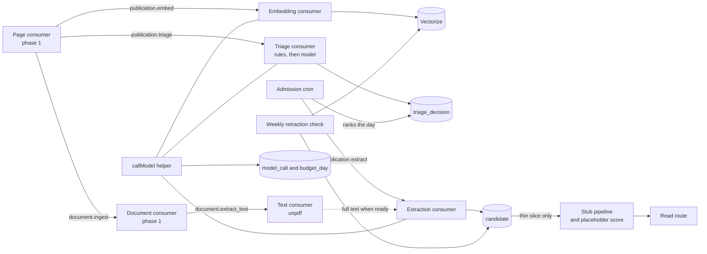

# Phase 2 solution

## Outcome

Phase 1 stores publications from OpenAlex and arXiv. Phase 2 makes them understood: every publication gets an embedding and is searchable by meaning, a cheap triage step picks the publications worth reading, opportunity extraction turns those into quoted candidate opportunities, and every model call is recorded and kept within a daily budget. A thin slice carries one fixture publication through every later layer with stubbed agents, so the final output shape can be judged before phase 3 builds the agents.

Phase 2 is done when the [exit criteria](../roadmap.md#exit-criteria) hold: recall at 10 of at least 0.8 on the fixture corpus, triage and extraction at their golden-set thresholds within the daily budget, and the thin slice running end to end.

## Scope

| Area | Requirements | What is built |
|---|---|---|
| Full text | REQ-DATA-006 | Text extraction from stored, licensed PDFs with unpdf (ADR 0009); abstract fallback |
| Retractions | REQ-DATA-008 | Weekly retraction check, flag handling, vector removal, hidden opportunities |
| Embeddings and search | REQ-PROC-001, REQ-PROC-002, REQ-PROC-003 | Embedding of title and abstract, Vectorize index with source and date metadata, a search function for agents, versioned indexes with backfill |
| Triage | REQ-PROC-005, REQ-PROC-006, REQ-PROC-008 | Scope and completeness rules, the five-signal model step, the code decision, daily admission |
| Extraction | REQ-PROC-004, REQ-PROC-009 | The extraction step, the quote check, candidate rows |
| Thin slice | REQ-PROC-007 | Stubbed pipeline steps, a placeholder score, one read route, one command |
| Model calls and cost | REQ-NFR-003, REQ-NFR-005, REQ-NFR-011 | One model-call helper through AI Gateway, a usage record per call, a daily budget with a stop |
| Throughput | REQ-NFR-010 | Queue sizing and a load test on recorded fixtures with stubbed models |
| Contract tests | REQ-TEST-002 | Contract tests for triage and extraction that call no live model |

## Out of scope

- The six analysis agents, the search tool, and the per-candidate Workflow with real agents: phase 3. The thin slice uses stub steps in their place.
- The scoring engine, data API, auth and admin API, and dashboard: phase 4. The thin slice gets one read-only route, local and preview only (ADR 0058).
- User-facing opportunity search (REQ-API-006, REQ-DASH-015): phase 4. Phase 2 builds the search function it will call.
- Semantic Scholar (REQ-DATA-003) and wider full-text use: wait for the legal answer to OQ-014 ([review brief](../legal/review-brief.md)).
- External model providers for pipeline steps: Workers AI only (ADR 0049).

## Data flow

- Embedding and triage start from the same stored publication and do not wait for each other. Rejected publications are still embedded, so they stay searchable (REQ-PROC-005 AC3).
- Extraction runs only for admitted publications. A publication is admitted only when its full text is stored or cannot come, or after `extraction.full_text_wait_hours` (REQ-PROC-011, ADR 0065). Extraction then reads the full text when it is stored, and the abstract otherwise; the envelope's `InputMode` says which (REQ-DATA-006 AC3).
- Every model call, embeddings included, goes through one helper, which writes the usage record and checks the budget (REQ-NFR-003, REQ-NFR-005, REQ-NFR-011).

## Reused from phase 1

The contracts, decision rule, and eval runner already exist and are reused unchanged:

- `decideTriage`, `admitWithinDailyLimit`, and the triage schemas in `packages/models/src/triage.ts`.
- `extractionOutputSchema` and `extractionMissingQuotes` in `packages/models/src/extraction.ts`.
- `agentEnvelopeSchema`, `repairModelOutput`, and `missingQuotes` in `packages/models/src/agent-contract.ts`.
- The idempotent message claim (`claimMessage`) and retry delays in `apps/pipeline/src/queue/`.
- `industriesForTopics` and the topic map in `apps/pipeline/src/normalize/scope.ts`.
- The model-free eval runner in `agents/extraction/src/eval.ts` and its golden sets.
- The test harness, SQLite stand-in for D1, and fake queue and bucket in `apps/pipeline/src/test/`.
