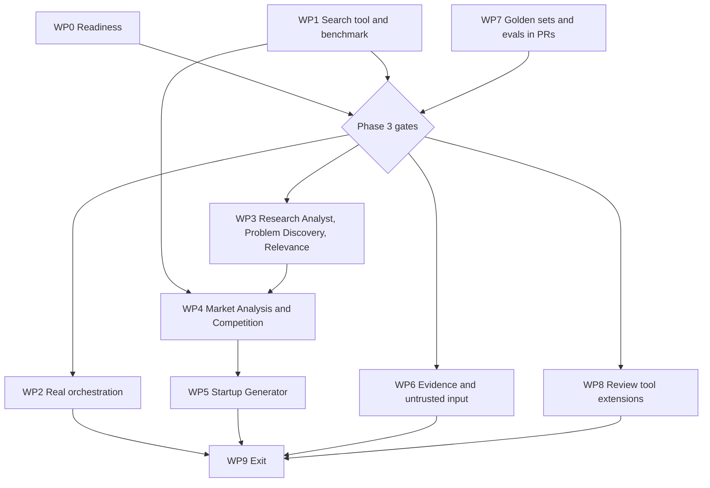

# Phase 3 dependencies

## Gates

Phase 3 starts only when every gate below is closed ([Definition of Ready](../roadmap.md#definition-of-ready-for-a-phase)). WP0, WP1, and WP7 of the [build plan](build-plan.md) may run before then, because the gates need them.

| Gate | State on 2026-11-28 | Owner | Evidence that closes it |
|---|---|---|---|
| Phase 2 exit | Open. The build is done; staging day 1 started on 2026-11-28 | Lead engineer | The [phase 2 exit evidence](../phase-2/exit-evidence.md) complete, and the phase 2 requirements `done` |
| OQ-033: search provider | Candidates fixed (ADR 0022); benchmark not run | AI engineering lead | An ADR that supersedes ADR 0022 (WP1) |
| OQ-036: models for the remaining agents | Answered for Problem Discovery and Relevance; Research Analyst provisional (ADR 0107); Market Analysis, Competition, and Startup Generator open, after OQ-033 | AI engineering lead | Benchmark ADRs on the golden sets |
| OQ-020: judges | Problem Discovery judge report-only (ADR 0111); judges for Market Analysis, Competition, and Startup Generator open | AI engineering lead | An ADR per judge, or code checks instead |
| Golden sets and thresholds | Research Analyst, Problem Discovery, and Relevance in place; three agents missing | `@SolarnodeCC` | Entries confirmed by the owner, with thresholds written before the first run (REQ-TEST-005) |
| Requirement and agent documents approved | `requirements/agents.md` approved on 2026-11-07; re-review needed after ADRs 0093 to 0111 | Product owner | WP0 |
| Cost target | At most EUR 2 per complete opportunity until the calibrated budget ([overview](../overview.md#success-measures), ADR 0023) | Lead engineer | The measured phase 2 cost and the WP9 run |

## Order of the work packages

- WP4 needs the Research Analyst and Problem Discovery output of WP3 as its input, and the search tool of WP1.
- WP2 and WP3 can run in parallel: WP2 works on stubbed models, and WP3 on the golden sets.
